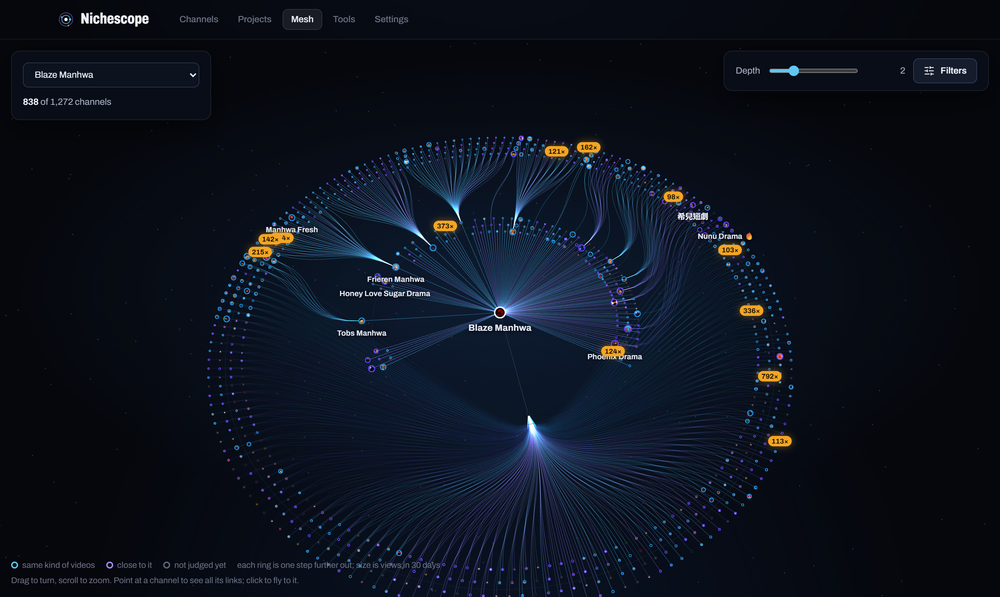
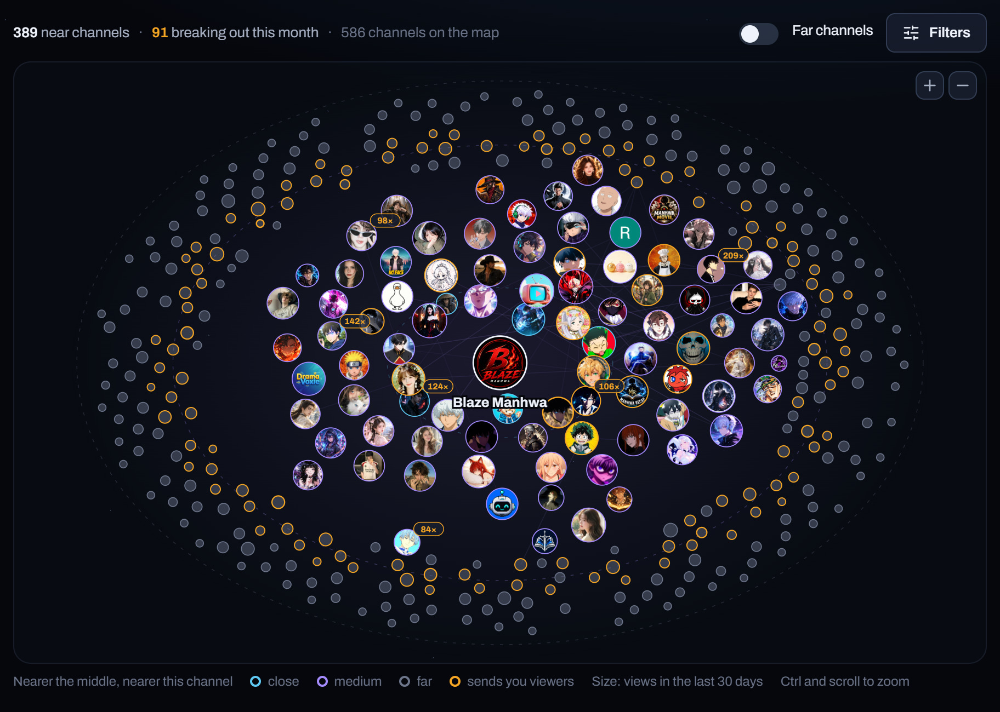
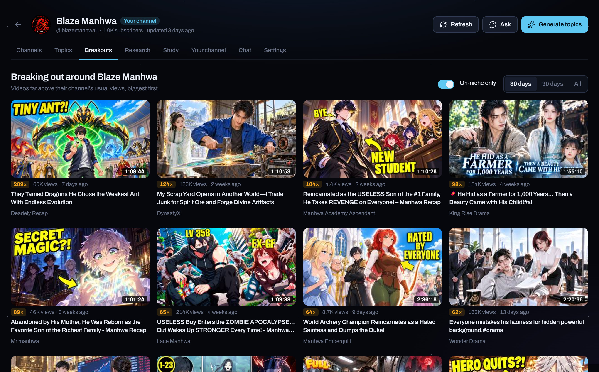
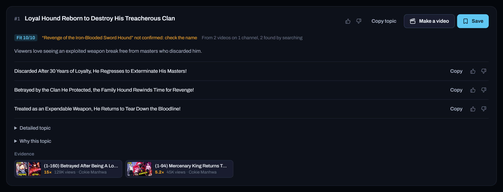
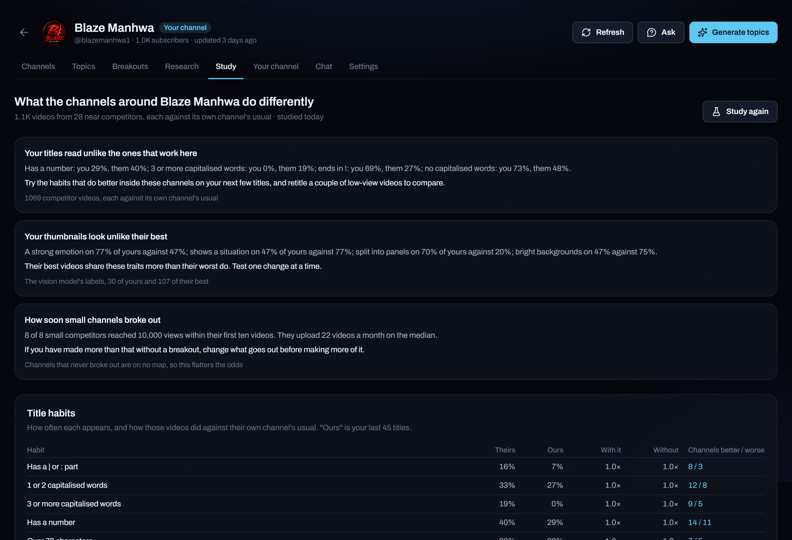
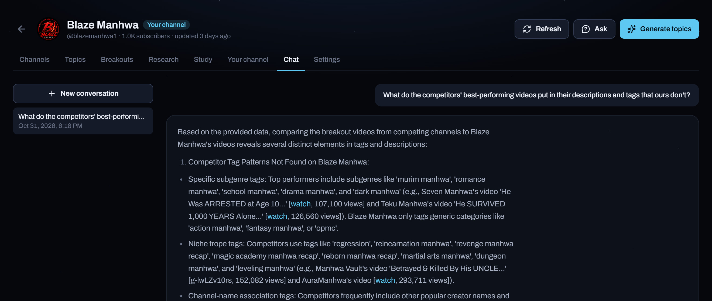
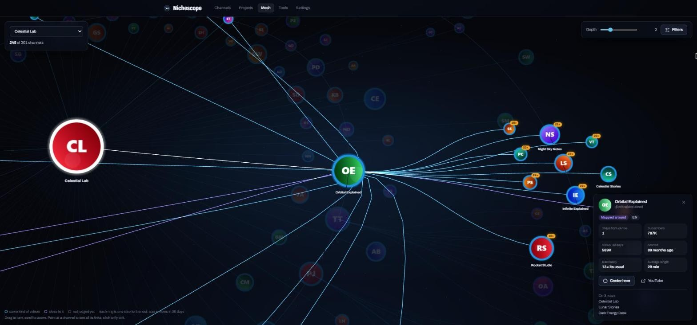
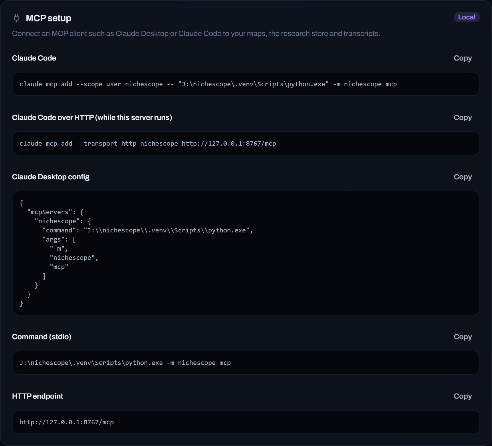
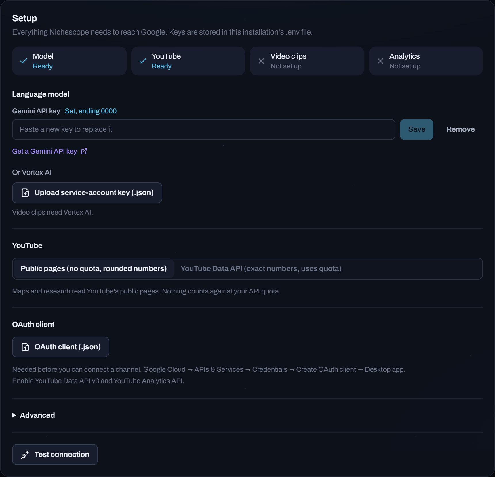

<p align="center">
  <picture>
    <source media="(prefers-color-scheme: dark)" srcset="docs/images/logo-dark.svg">
    <source media="(prefers-color-scheme: light)" srcset="docs/images/logo-light.svg">
    
  </picture>
</p>

<p align="center">
  <strong>Find the channels your viewers also watch, what is taking off among them, and what to make next.</strong><br>
  Runs on your own machine. Works from the browser, the command line or any MCP client.
</p>

<p align="center">
  <a href="#get-started">Get started</a> ·
  <a href="docs/guide.md">Guide</a> ·
  <a href="docs/ai-clients.md">AI clients</a> ·
  <a href="docs/settings.md">Settings</a>
</p>

<p align="center">
  
</p>

<table>
  <tr>
    <td width="33%" align="center"><strong>Niche maps</strong><br><sub>The channels YouTube puts next to yours, ring by ring</sub></td>
    <td width="33%" align="center"><strong>Breakouts</strong><br><sub>Videos doing three times their channel's usual or more</sub></td>
    <td width="33%" align="center"><strong>Topic ideas</strong><br><sub>Each one tied to the real videos behind it</sub></td>
  </tr>
</table>

## Map a niche

Paste a channel. Nichescope reads what YouTube recommends beside its videos and builds the
map from that: the channels shown most often sit closest. Off-topic channels that just
share viewers, like sports, news or music, are set aside so the map stays on your subject.

<p align="center"></p>

## See what is taking off

The channels around yours are read in full, and any video far above its channel's usual
views is flagged. Sort by how far it beat the usual, filter to the last 30 or 90 days.

<p align="center"></p>

## Topic ideas

Ask for topics and each one comes back with the breakouts it builds on, titles ready to
use, an expected range of views and a fit score. Name a subject, say "black holes" or "a
heist arc", and it is searched first so every idea is about it. Ideas already covered on
YouTube are flagged.

<p align="center"></p>

## Competitor study

The study compares your near competitors' best and worst videos with yours: which title
habits go with their breakouts, how their best thumbnails look against yours, and how soon
small channels in the niche broke out. It ends in a short list of what to change first.

<p align="center"></p>

## Ask about your niche

Chat with the map: what is working, who is growing, what to try next. Answers name the
channels they lean on, and you can attach screenshots or documents.

<p align="center"></p>

## Every map in one view

The mesh puts all your maps on rings around one channel. Point at a channel to light up
its links. Click it to fly there.

<p align="center"></p>

## Use it from your AI client

Everything above is also available to Claude Desktop, Claude Code and other MCP clients.
Settings shows the exact command to copy.

<p align="center"></p>

## Get started

You need Python 3.10 or newer, Node.js 20 or newer and a Gemini API key.

**Windows:** double-click `start.bat`. The first run sets everything up, then the app opens
in your browser.

**Anywhere else:**

```bash
python -m venv .venv && source .venv/bin/activate
pip install -e .
(cd web && npm install && npm run build)
nichescope serve
```

Then open **Settings** and paste your key. That is all it needs to map channels.

<p align="center"></p>

## Documentation

- [Getting started](docs/getting-started.md)
- [Guide](docs/guide.md)
- [AI clients](docs/ai-clients.md)
- [Settings](docs/settings.md)

## License

MIT. See [LICENSE](LICENSE).
