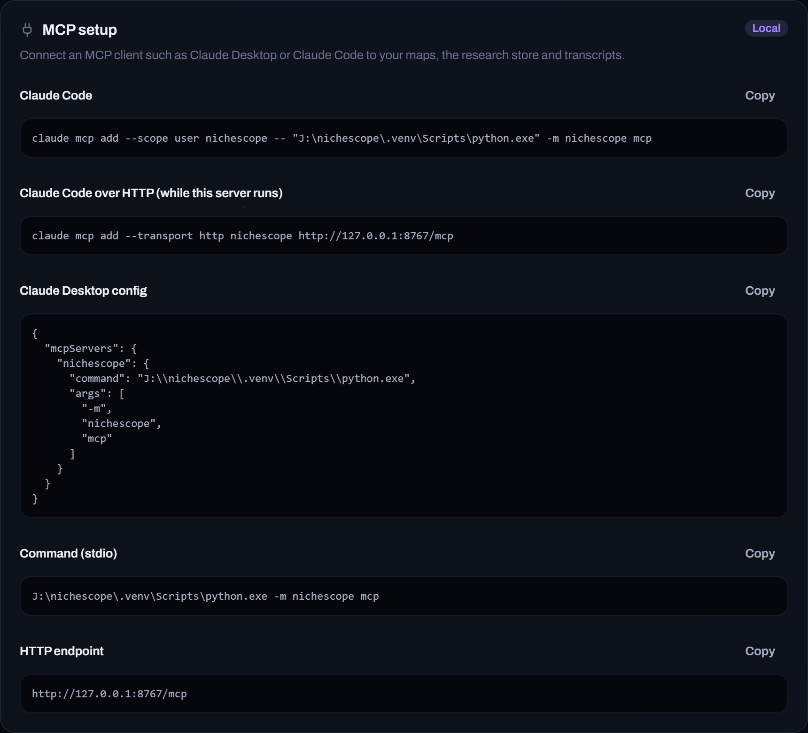

# AI clients

Nichescope works as an MCP server, so Claude Desktop, Claude Code and other MCP clients can
read your maps, search the research store and generate ideas for you.

<p align="center"></p>

## Connect

Open **Settings** and scroll to **MCP setup**. It shows the command for your machine with the
paths filled in; press **Copy** and run it, or paste the config into your client.

For Claude Code:

```bash
claude mcp add --scope user nichescope -- <project>/.venv/Scripts/python.exe -m nichescope mcp
```

While `nichescope serve` is running you can connect over HTTP instead:

```bash
claude mcp add --transport http nichescope http://127.0.0.1:8765/mcp
```

## What it can do

| Tool | What it does |
| --- | --- |
| `status` | Your maps and what is set up |
| `get_map` | A map's channels, nearest first |
| `get_breakouts` | Recent breakouts on a map |
| `find_videos` / `find_channels` | Search everything that has been read |
| `who_sends_viewers` | Channels that recommend a channel |
| `youtube_search` | A live YouTube search |
| `get_channel` / `get_video` | One channel or video in detail |
| `get_transcript` / `get_thumbnail` | A video's captions or thumbnail |
| `map_channel` | Map a new channel |
| `add_competitors` / `remove_competitor` | Edit a map's channels |
| `set_learning` | Leave a channel out of ideas and answers |
| `recheck_map` | Judge again which channels belong on a map |
| `remove_map` / `list_removed_maps` | Remove a map, or bring one back |
| `generate_topics` / `follow_up_topics` | Topic ideas, and follow-ups on a run |
| `list_topic_runs` / `get_topic_run` | Earlier runs in full |
| `mark_topic` / `topic_settings` | Likes, rejections and run settings |
| `ask` | A question about a niche |
| `get_study` / `run_study` | The competitor study of a map, or a fresh one |

Two prompts are included: `niche_report` for a briefing on a niche, and `plan_next_video`
for a plan for one video.

## Try asking

- "What is breaking out around my channel this month?"
- "Find videos in my niche with at least 5x their usual views and under 10k subscribers."
- "Give me five ideas about castles, with titles."
- "Who are my closest competitors, and which of them is growing fastest?"
