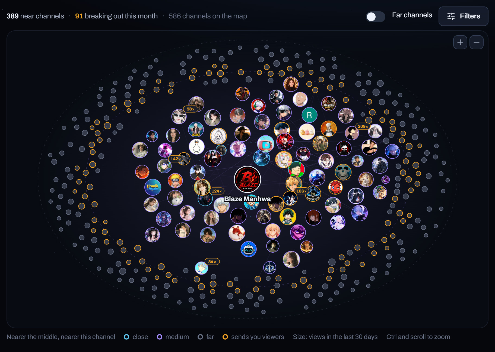
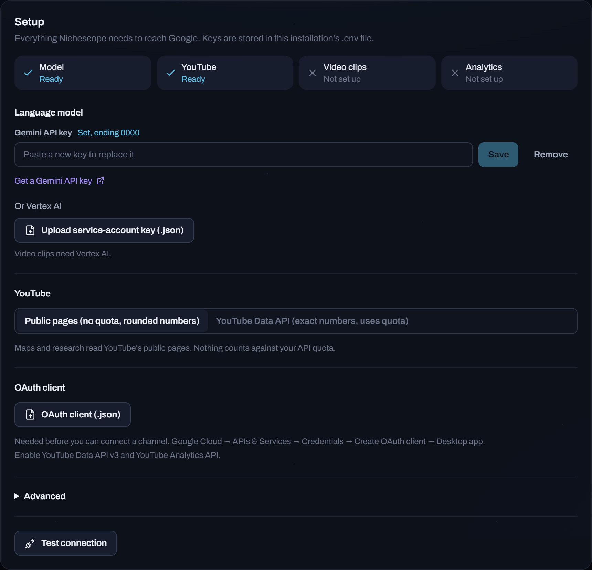

# Getting started

<p align="center"></p>

## What you need

- Python 3.10 or newer
- Node.js 20 or newer, to build the web app once
- A Gemini API key from Google AI Studio

## Install and run

On Windows, double-click `start.bat`. The first run creates the Python environment, builds
the web app and opens it at <http://127.0.0.1:8765>. Later runs just start it. Close the
window to stop it.

On macOS or Linux:

```bash
python -m venv .venv && source .venv/bin/activate
pip install -e .
(cd web && npm install && npm run build)
nichescope serve
```

## Add your key

Open **Settings**. Paste the Gemini key under *Language model* and press **Save**. The four
tiles at the top turn green as each part is ready, and **Test connection** checks each
one.

<p align="center"></p>

Keys are saved to `.env` in the project folder and are only sent to the service they belong to.

## Map your first channel

On **Channels**, paste a channel name, link or @handle and press **Add a channel**. Pick how
many steps out to go: one step reads the channels next to it, each extra step reads the
channels next to those. One or two steps is plenty to start; you can go further later.

Mapping runs in the background. The bar at the bottom shows progress, and the map opens
when it is done.

## Next

- [Guide](guide.md): reading a map, breakouts, topic ideas, chat and research
- [AI clients](ai-clients.md): use Nichescope from Claude and other MCP clients
- [Settings](settings.md): every option

## Working on Nichescope

```bash
pip install -e ".[dev]"
ruff check src tests
pytest
cd web && npm run dev        # hot reload on :5173 while `nichescope serve` runs
```

Tests run offline and never call YouTube or the model.
