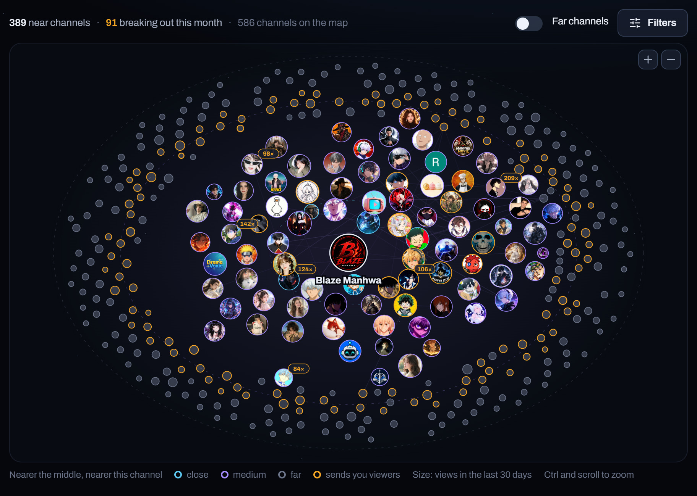
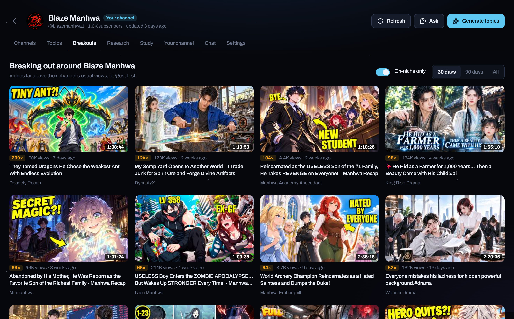
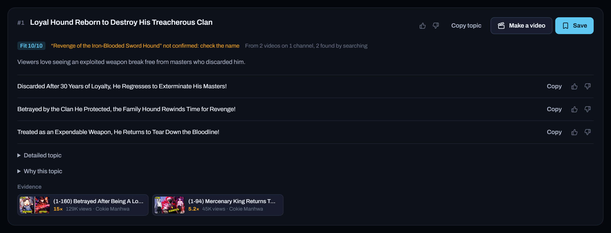
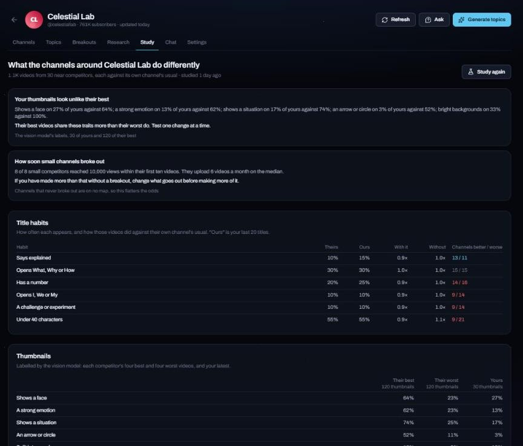
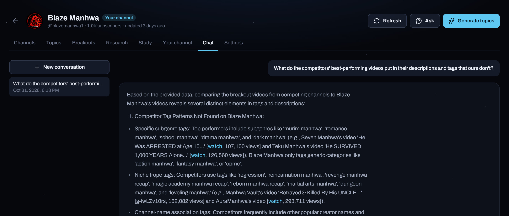
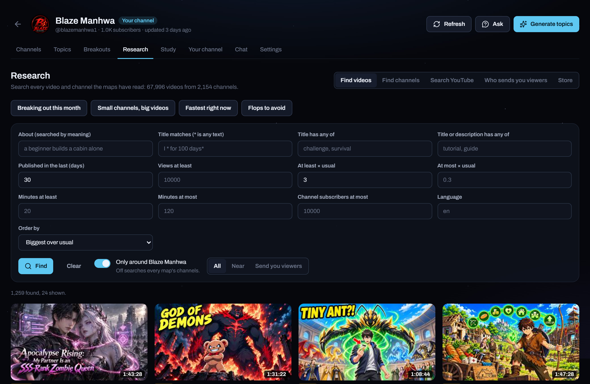
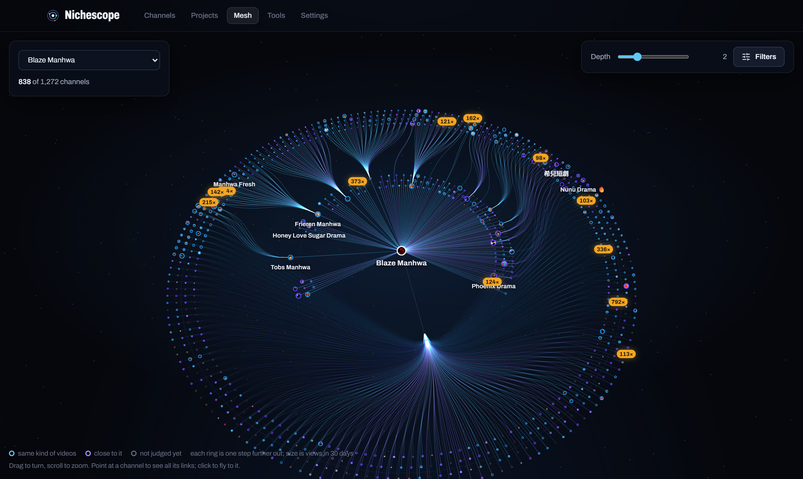
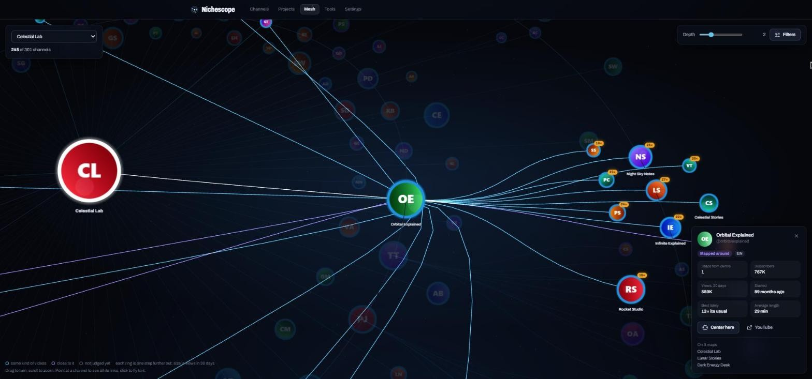

# Guide

## The map

The channel you mapped sits in the middle. Around it are the channels YouTube recommends
beside its videos: the more often a channel shows up, the closer it sits.

- **Close** channels appear beside half or more of its videos, **medium** beside a fifth.
  **Far** ones turned up less often and are hidden until you switch them on.
- Bigger circles had more views in the last 30 days.
- An amber tag is the biggest recent breakout on that channel.
- Point at a channel to see who it is linked to. Click it for its numbers and breakouts.

On the right, the checked channels are the ones topics, breakouts and answers learn from.
Untick one to leave it out without removing it.

### Keeping the map on your subject

Channels that share your viewers but make something else, like sports, news, music or
gaming, are set aside. Open **set aside** to see them with a title they were recommended
with. **Keep** brings one back for good. **Check every channel again** re-judges the whole
map, which is useful after a big change.

To add a competitor YouTube did not show, type it under **Add competitors**. Remove a
channel with the cross next to its name; it stays removed through refreshes and can be
restored from the bottom of the list.

### Going further out

**Map around it** on any channel reads the channels next to that one too. Channels that
several neighbours point to are brought closer. Maps refresh about once a day while the
app is running.

## Breakouts

A breakout is a video with at least three times its channel's usual views. The number on
each card is how many times the usual it did. Choose 30 days, 90 days or all time.
**On-niche only** hides breakouts that are off your subject.

## Topic ideas

**Generate topics** writes a run of ideas. Every idea lists the videos it builds on, so you
can see why it was suggested. Each comes with:

- titles ready to use, with a like or reject button on each
- a fit score and an expected range of views
- a detailed brief and the reasoning: what proves demand, what is missing, the angle and the risk
- your own video closest to it, and a warning if someone has already covered it
- for an idea about a named series, game, person or place, where that name is written; a name
  no cited video carries is marked *not confirmed*

Type what you want before generating. If you name a subject, it is searched on the map and
on YouTube first, every idea is about it, and the run says what was found. Instructions
about style ("shorter titles", "no lists") are followed without a search.

Continue a run underneath it: ask for more ideas in a direction, more titles for one idea,
or the reasoning behind one. Likes and rejections carry into later runs. **Save** keeps an
idea in your list with a status.

Ideas build their hooks from how the strongest videos open, and anything your channel has
already made by name is left out. Ideas never repeat across runs, and each run starts from breakouts the earlier runs did not
use.

## Study

**Study the competitors** reads the near channels on the map that have got going on their
own and compares each video with its channel's usual views.

- **Findings** come first: what is holding the channel back, biggest first, each with what
  it is based on.
- **Title habits** shows how often each habit appears, how videos with it did against those
  without, and in how many channels it did better or worse. *Ours* is your recent titles.
- **Thumbnails** compares the styles of each competitor's best and worst videos with yours.
- **How soon small channels broke out** shows which video first reached 10,000 views.

For your own connected channel the study also reads how your openings hold against similar
videos, where your long videos' views come from, and whether a setting holds them back. It
refreshes once a week while the app runs.

## Chat

Ask anything about the niche. Answers use the map's channels, breakouts and your own videos,
and list the channels they mention. Attach images, PDFs, Word or text files when they help.

## Research

Every channel and video Nichescope reads is kept, so you can search all of it: by subject
in plain words, title pattern (`I * for 100 days`), age, views, how far above usual, length,
channel size and language. The presets at the top cover the common questions. **Search
YouTube** runs a live search, **Who sends viewers** shows which channels recommend a given
one.

## Mesh

The mesh joins every map into one view. The chosen channel is in the middle and each ring is
one step further out; each channel hangs from the neighbour it is most linked to.

- Cyan rings are channels that make the same kind of videos, violet ones are close to it.
- Point at a channel to dim everything else and light its links. Click to fly to it.
- **Depth** chooses how many rings to show. **Filters** narrow by size, age, language or breakouts.
- **Center here** on a channel's card re-centres the whole view on it.

## Your own channel

Connect your channel in Settings and its map also shows the channels that really send you
viewers, your traffic sources and how well each video held viewers.

YouTube only shows impressions and click-through rate in Studio, so bring them in from
there: in Studio open **Analytics**, **Advanced mode**, add *Impressions* and *Impressions
click-through rate*, then **Export current view**. Upload the file with **Import from
Studio** on the *Your channel* tab. Each video is then judged on both:

- **Working**: people click and stay. Make more like it.
- **Fix the packaging**: people stay but few click. Change the title or thumbnail.
- **Fix the opening**: people click, then leave. The start does not deliver.
- **Weak**: few click and few stay.
