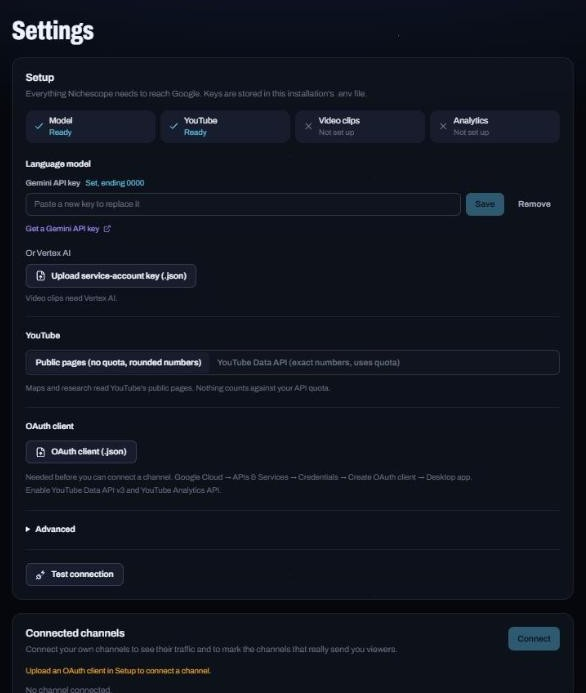

# Settings

The **Setup** panel in Settings covers everything most people need: paste a key, upload a
file, press **Test connection**. Changes apply at once, without a restart.

Behind the panel, settings live in `.env` in the project folder. You can edit that file by
hand instead; `.env.example` lists every option.

## Common options

| Setting | Default | What it does |
| --- | --- | --- |
| `GEMINI_API_KEY` | | Your Gemini API key |
| `VERTEX_CREDENTIALS` | | A Google Cloud service-account file, used instead of the key |
| `YOUTUBE_SOURCE` | `public` | `api` uses the YouTube Data API for exact numbers |
| `YOUTUBE_API_KEY` | | Needed only with `YOUTUBE_SOURCE=api` |
| `NICHESCOPE_PORT` | `8765` | Port for the web app |
| `NICHESCOPE_DATA_DIR` | `data` | Where maps and the research store are kept |

The model names can be changed under **Advanced** in the panel.

## Connecting your own channel

Connecting a channel adds its real traffic to its map. It needs a Google Cloud OAuth client:

1. In Google Cloud, enable the YouTube Data API v3 and the YouTube Analytics API.
2. Create an OAuth client of type *Desktop app* and download its file.
3. Upload it under **OAuth client** in Setup, then press **Connect** under *Connected channels*.

Access is read-only.

## Privacy

Nichescope has no accounts and no server of its own. Keys stay in `.env`, uploaded files in
`credentials/`, and maps in `data/`; all three are kept out of version control. The web app
only listens on your own machine. Do not expose it to a network.
